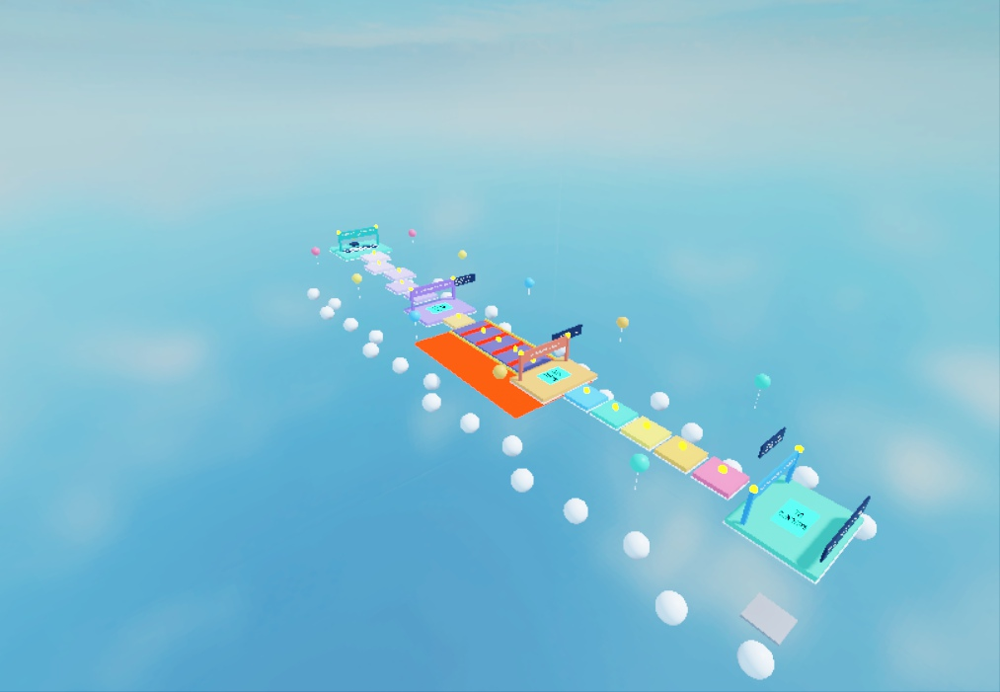
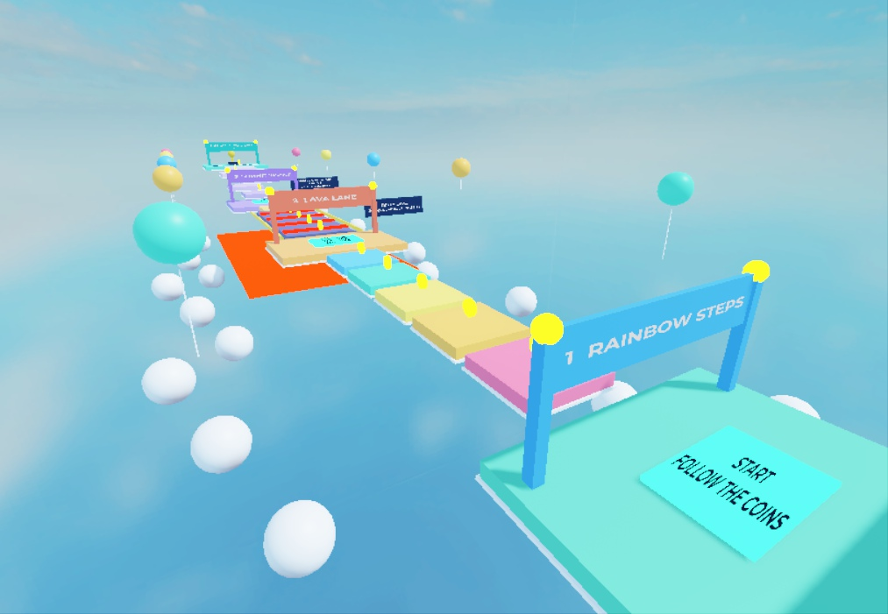
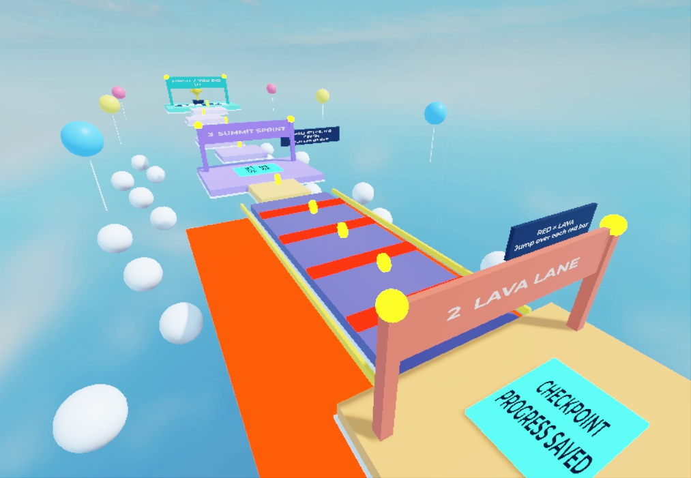
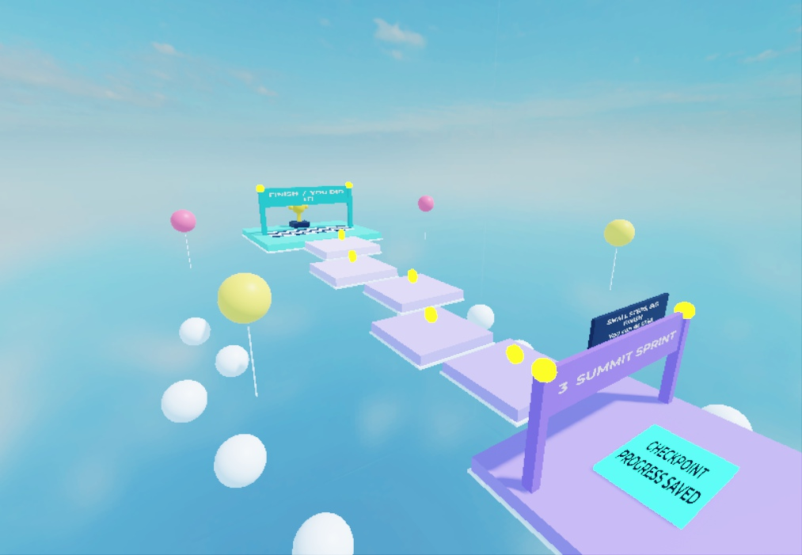
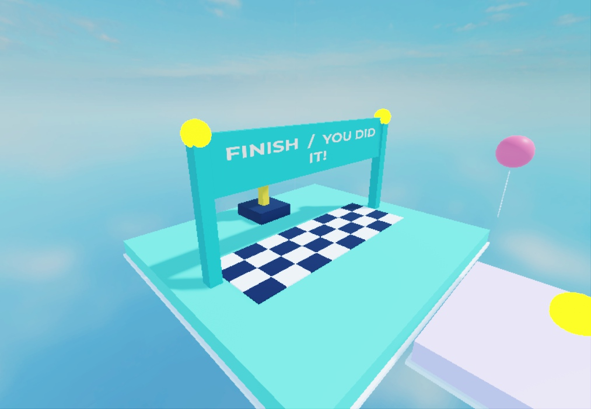
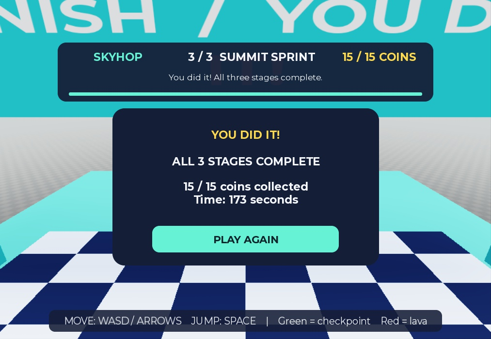

# Skyhop Obby v1.0

Skyhop is a beginner-friendly Roblox obstacle course above the clouds. Jump across three stages, collect 15 coins, and reach the checkered finish gate. Green pads save your checkpoint, and collected coins disappear for you and stay collected if you fall or touch lava during the same run.

## Play in Roblox Studio

Open [Skyhop-v1.0.rbxl](versions/v1.0/Skyhop-v1.0.rbxl) in Roblox Studio and click **Play**. Move with **WASD** or the arrow keys and jump with **Space**. The finish card shows your time and coin total. Select **Play Again** to reset the run.

| Stage | What to do |
| --- | --- |
| **Rainbow Steps** | Jump across five wide, colorful stepping stones. |
| **Lava Lane** | Jump over four glowing bars and cross the exit gap above the lava pool. |
| **Summit Sprint** | Climb five rising platforms to the trophy and checkered finish. |

## How Codex and Roblox Studio built the course

The project was inspired by Kevin Stratvert’s [How to Make a Roblox Game with ChatGPT Codex](https://www.youtube.com/watch?v=tSnTC_gdaw0&t=5s). The tutorial inspired the workflow and the [initial obstacle-course brief](versions/v1.0/BUILD-PROMPT.md). Skyhop’s layout and Luau scripts were built for this project.

Codex turned the brief into Luau and sent tool requests to Roblox’s local Studio MCP server. MCP stands for Model Context Protocol. In this session a small Python CLI client started Roblox’s `StudioMCP.exe`, exchanged MCP requests and results over standard input and output, and included the active Studio instance ID with each request. Studio ran the Luau against its own project and returned the result. [Roblox Studio MCP setup guide](https://create.roblox.com/docs/studio/mcp)

1. **Build in Edit mode.** Codex sent `execute_luau` calls to create the platforms, coins, checkpoints, hazards, and finish under `Workspace.SkyhopObby`. It installed a server script for gameplay rules and a client script for the HUD, coin visuals, and finish effects.
2. **Playtest.** Codex used `start_stop_play` and Luau calls against the playtest’s server and client. It drove the Humanoid through jumps, checked server coin totals and checkpoint state, and inspected what the HUD displayed. The first summit test led to wider landings.
3. **Capture and save.** Studio saved the original course as a local `.rbxl` file. For this README, Codex opened a separate copy and called `screen_capture` with explicit camera positions to capture each stage.

To set up your own connection, open **Assistant → … → Manage MCP Servers** in Studio and enable **Studio as MCP server**. Use Codex’s quick connect option if available, and use `list_roblox_studios` to identify the open place. The full setup options are in the [Roblox Studio MCP guide](https://create.roblox.com/docs/studio/mcp).

## Connect Roblox Studio to Claude Code through MCP

Claude Code can use the same local Roblox Studio MCP server as Codex. Claude Code sends tool calls, and Studio runs them against the open place and returns the results. For example, Claude Code can use `search_game_tree` to inspect the course, `execute_luau` to edit it, and `start_stop_play` to run a playtest. [Roblox Studio MCP tools](https://create.roblox.com/docs/studio/mcp#how-the-studio-mcp-server-works)

1. With Claude Code installed, open your place in Roblox Studio. In Studio, go to **Assistant → … → Manage MCP Servers** and turn on **Enable Studio as MCP server**.
2. In **Assistant Settings → MCP Servers → Quick connect**, select **Claude Code CLI** (listed as **Claude Code** in Roblox’s guide). If it’s missing, restart Studio after installing Claude Code. [Roblox Quick Connect guide](https://create.roblox.com/docs/studio/mcp#quick-connect)
3. Start a new local Claude Code session and enter `/mcp` to check the connection. Then ask Claude Code to list your open Studio places with `list_roblox_studios` and inspect `Workspace.SkyhopObby`. [Anthropic’s Claude Code MCP guide](https://code.claude.com/docs/en/mcp#managing-your-servers)

## Screenshots

**Rainbow Steps**

**Lava Lane**

**Summit Sprint**

**Finish gate**

**Original playtest result**

## Source and verification

- [Version 1.0 archive](versions/v1.0/README.md) contains the full place, a native model backup, and restoration instructions.
- [World builder](versions/v1.0/build_world.luau), [server gameplay](versions/v1.0/course.server.luau), and [client HUD](versions/v1.0/course.client.luau) show how the course works.
- [Original playtest notes](versions/v1.0/PROJECT.md) link the results for stage traversal, coin disappearance, lava and fall recovery, and replay. These were single-client Studio tests. Multiplayer and mobile layouts were outside that test run.
